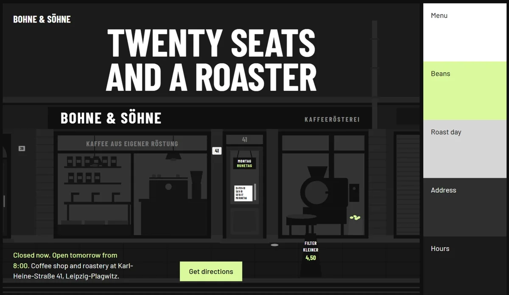
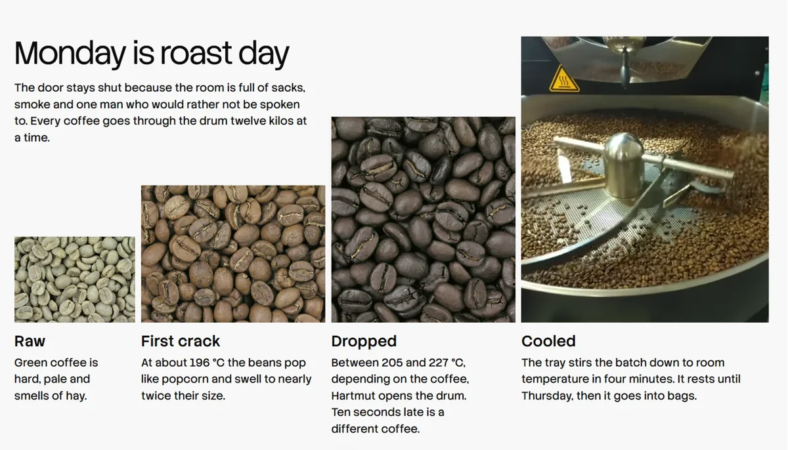
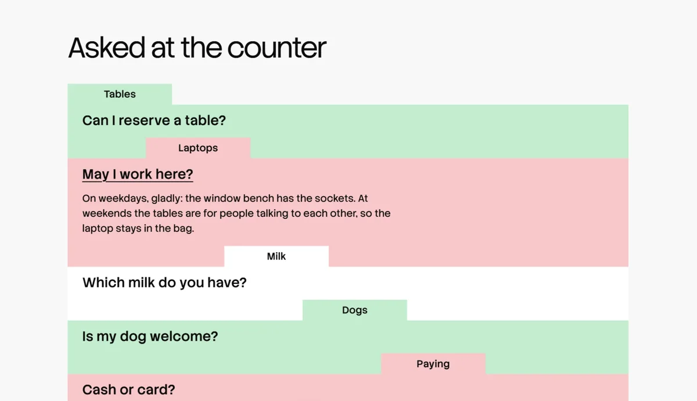

[English](README.md)

<p align="center">
  <picture>
    <source media="(prefers-color-scheme: dark)" srcset="assets/taste-skill-wordmark-dark.png" />
    
  </picture>
</p>

<p align="center">
  <a href="https://tasteskill.dev" title="造訪 tasteskill.dev"></a>
  &nbsp;
  <a href="https://tastecode.dev" title="造訪 tastecode.dev"></a>
  &nbsp;
  <a href="LICENSE"></a>
  &nbsp;
  <a href="CHANGELOG.zh-TW.md"></a>
</p>

<p align="center">
  <a href="https://tastecode.dev">
    <picture>
      <source media="(prefers-color-scheme: dark)" srcset="assets/readme-tastecode-dark.webp" />
      
    </picture>
  </a>
</p>

<h3 align="center">贊助者</h3>

<table align="center">
  <tr>
    <td align="center" width="104">
      <a href="https://interfaces.dev/?utm_source=tasteskill&utm_medium=sponsorship">
        
      </a>
    </td>
    <td><sub><a href="https://interfaces.dev/?utm_source=tasteskill&utm_medium=sponsorship"><strong>interfaces.dev</strong></a> · 設計工程雜誌，作者為 <a href="https://github.com/jakubkrehel"><strong>Jakub Krehel</strong></a></sub></td>
  </tr>
  <tr>
    <td align="center" width="104">
      <a href="https://reactbits.dev">
        <picture>
          <source media="(prefers-color-scheme: dark)" srcset="assets/sponsors/reactbits-icon-dark.svg" />
          
        </picture>
      </a>
    </td>
    <td><sub><a href="https://reactbits.dev"><strong>React Bits</strong></a> · 為創意介面打造的 React 動畫元件</sub></td>
  </tr>
  <tr>
    <td align="center" width="104"><a href="https://img.ly/"></a></td>
    <td><sub><a href="https://img.ly/"><strong>IMG.LY</strong></a> · CreativeEditor SDK</sub></td>
  </tr>
  <tr>
    <td align="center" width="104"><a href="https://www.sent.dm"></a></td>
    <td><sub><a href="https://www.sent.dm"><strong>Sent.dm</strong></a> · 支援 SMS、WhatsApp、RCS 的訊息 API</sub></td>
  </tr>
</table>

<p align="center"><sub><a href="https://github.com/sponsors/Leonxlnx">成為贊助者</a></sub></p>

**Taste Skill** 是協助 coding agent 設計網站與 App 畫面的 Agent Skill，讓它做出明確設計決策。它提供藝術指導、真實圖片，以及在真實瀏覽器檢查自己作品的方法。

以下頁面各由一份需求說明建立：

<table>
  <tr>
    <td width="50%"></td>
    <td width="50%"></td>
  </tr>
  <tr>
    <td width="50%"></td>
    <td width="50%"></td>
  </tr>
</table>

這些是真實照片，由 skill 從開放典藏搜尋並標示出處，見[署名清單](examples/v2/CREDITS.zh-TW.md)。也可觀看[發布影片](https://github.com/Leonxlnx/taste-skill/releases/tag/v2.0.0)。

## 安裝

```bash
npx skills add https://github.com/Leonxlnx/taste-skill --skill "design-taste-frontend"
```

此命令用 [`npx skills`](https://github.com/vercel-labs/agent-skills) CLI 安裝技能。

腳本需要 **Node 22+**，以及已安裝的 **Chrome、Edge 或 Chromium**。它不會安裝其他軟體，也不需要 API key；搜尋圖片需要網路。

<details>
<summary>Claude Code plugin</summary>

在 Claude Code 內執行下列命令。技能使用 `taste-skill:` namespace，避免與其他技能衝突。

```
/plugin marketplace add Leonxlnx/taste-skill
/plugin install taste-skill@taste-skill
```

日後用 `/plugin update` 更新。

</details>

<details>
<summary>Codex plugin</summary>

```bash
codex plugin marketplace add Leonxlnx/taste-skill
codex plugin add taste-skill@taste-skill
```

完成後開啟新的 Codex 工作階段以載入技能。

</details>

<details>
<summary>從 clone 以符號連結安裝</summary>

`./install.sh` 將技能符號連結至 Claude Code；`--codex` 安裝至 Codex，`--all-agents` 兩者皆安裝。之後 `git pull` 即原地更新。

</details>

已安裝時重新執行安裝命令即可，安裝名稱不變。舊技能位置請見[已搬遷的技能](#已搬遷的技能)。

## v2 如何運作

此技能來自 247 個精選網站的研究，製作流程有六步：

1. 閱讀需求，列出客戶獨有的素材。
2. 腳本從 20 個研究方向抽出三個，由 agent 選一個。
3. 找出構想，以一句話串起客戶素材與該方向。
4. 使用開放典藏的真實圖片、影片製作，標示出處。
5. 在真實瀏覽器以三種寬度檢查，低品質項目判為失敗。
6. 檢視自己截圖，修正前三個問題，最多三輪。

一次製作約需 30 至 45 分鐘與數十萬 tokens。詳見[更新紀錄](CHANGELOG.zh-TW.md)與[研究](skills/taste-skill/references/research.zh-TW.md)。

儀表板與 App 畫面自 v2.1 起有獨立流程：從真實產品畫面提煉的風格抽選一種，依量測建立外殼、資料、圖表與表格，再以 App 規則檢查，包括低調面板、對齊數字、色彩用於資料、手機導覽收起。產品到達頁展示的 App 片段也依此製作，讓它像可運作的產品。

v2.1 也檢查外框：首屏清楚標題、等邊界、區段不擠一側、不隨機空白；動態則依最新 100 個 Awwwards Sites of the Day 量測而來。

## 已搬遷的技能

本儲存庫只保留 `design-taste-frontend`。其他技能搬到獨立儲存庫，安裝名稱不變：

| 安裝名稱 | 目前位置 |
| --- | --- |
| `high-end-visual-design`, `minimalist-ui`, `industrial-brutalist-ui`, `gpt-taste`, `stitch-design-taste`, `design-taste-frontend-v1`, `design-taste-frontend-v2-experimental` | **[Leonxlnx/taste-skill-classics](https://github.com/Leonxlnx/taste-skill-classics)** |
| `imagegen-frontend-web`, `imagegen-frontend-mobile`, `brandkit`, `image-to-code` | **[Leonxlnx/imagegen-skills](https://github.com/Leonxlnx/imagegen-skills)** |
| `redesign-existing-projects` | 已整合至 `design-taste-frontend`，修改前會用真實瀏覽器稽核既有頁面 |
| `full-output-enforcement` | 已移除。同類需求請見 **[Leonxlnx/unlazy](https://github.com/Leonxlnx/unlazy)** |

使用原安裝名稱，從新儲存庫安裝：

```bash
npx skills add https://github.com/Leonxlnx/taste-skill-classics --skill "high-end-visual-design"
```

## 常見問題

**技能需要什麼？**

Node 22 以上與 Chrome、Edge 或 Chromium。不安裝其他軟體、不使用 API key，只有找圖需要網路。

**圖片哪裡來，可以使用嗎？**

來自 Wikimedia Commons、Openverse、Met 等開放典藏。只提供 public domain、CC0、CC BY、CC BY-SA 素材，技能會在頁面標示署名。取得自有素材後可替換。

**支援 React、Vue、Svelte、純 HTML 嗎？**

支援。這些規則處理設計，適用各框架。

**適用儀表板與 App 畫面嗎？**

自 v2.1 起適用。技能先區分網頁與 App，再用獨立流程製作儀表板、管理、設定：抽選真實產品研究風格、低調面板、誠實資料圖表、獨立檢查 `inspect.mjs --app`。

## 支持專案

若 Taste Skill 對你有幫助，可以考慮贊助：

[在 GitHub 贊助](https://github.com/sponsors/Leonxlnx)

### 開放原始碼支持者

<table align="center">
  <tr>
    <td align="center" width="104"><a href="https://www.kimi.com"></a></td>
    <td><a href="https://www.kimi.com"><picture><source media="(prefers-color-scheme: dark)" srcset="https://kimi-file.moonshot.cn/prod-chat-kimi/kfs/4/1/2026-06-05/1d8h69mt3v89kkekg24gg" /></picture></a><br /><sub><a href="https://platform.kimi.ai?track_id=track-20f0d64bcaba419bb425a3e8c306f65d&aff=taste-skill"><strong>取得 Kimi API key</strong></a>: taste-skill 使用者首次購買可獲額外 10% API 額度。</sub></td>
  </tr>
  <tr>
    <td align="center" width="104"><a href="https://vercel.com/open-source-program"></a></td>
    <td><a href="https://vercel.com/open-source-program"></a></td>
  </tr>
</table>

### 社群贊助者

<p>
<a href="https://github.com/dnakov"></a>
<a href="https://github.com/AkramReshad"></a>
<a href="https://github.com/ajmalaksar25"></a>
<a href="https://github.com/krikkkk"></a>
<a href="https://github.com/navanchauhan"></a>
<a href="https://github.com/robinebers"></a>
<a href="https://github.com/JKc66"></a>
<a href="https://github.com/u2393696078-rgb"></a>
<a href="https://github.com/a-human-created-this"></a>
<a href="https://github.com/AtharvaJaiswal005"></a>
<a href="https://github.com/ghughes7"></a>
<a href="https://github.com/mccun934"></a>
<a href="https://github.com/techmedic5"></a>
<a href="https://github.com/bytewerk-dev"></a>
<a href="https://github.com/LuisGot"></a>
<a href="https://github.com/oskar-collab"></a>
<a href="https://github.com/denvit"></a>
<a href="https://github.com/onedollarstock"></a>
<a href="https://github.com/KANA-33"></a>
<a href="https://github.com/emilkowalski"></a>
<a href="https://github.com/AnthonyLiuVa"></a>
<a href="https://github.com/Wolfy18"></a>
<a href="https://github.com/Gigslol"></a>
</p>

<p align="center">
 <a href="https://www.star-history.com/leonxlnx/taste-skill">
  <picture>
   <source media="(prefers-color-scheme: dark)" srcset="https://api.star-history.com/badge?repo=Leonxlnx/taste-skill&theme=dark" />
   <source media="(prefers-color-scheme: light)" srcset="https://api.star-history.com/badge?repo=Leonxlnx/taste-skill" />
   
  </picture>
 </a>
</p>

<sub>回饋：建立 issue 或 pull request，私訊 [@lexnlin](https://x.com/lexnlin) or [@blueemi99](https://x.com/blueemi99),，或寄信至 [hello@tasteskill.dev](mailto:hello@tasteskill.dev).</sub>

<sub>Taste Skill 沒有官方代幣或加密貨幣專案。任何使用作者名稱、圖像或專案名的代幣均無關聯，也未獲作者認可。</sub>

## 授權

[MIT 授權](LICENSE) · Copyright (c) 2026 Leonxlnx

## 中文文件索引

本翻譯對應 upstream `6010f91`，採 zh-TW 標準書面語。英文 `SKILL.md` 仍是 agent 預設載入檔，中文對應檔供閱讀，不會改變安裝名稱或 runtime。上述安裝指令保留 upstream 來源；要連同此 fork 的中文文件取得，可 clone `https://github.com/djpken/taste-skill.git` 的 `zh-TW` 分支。

- [情境指南](skills/SKILL-ROUTING.zh-tw.md)
- [技能說明](skills/taste-skill/README.zh-TW.md)
- [完整技能指令](skills/taste-skill/SKILL.zh-TW.md)
- [App 畫面](skills/taste-skill/references/app-screens.zh-TW.md)
- [文案](skills/taste-skill/references/copy.zh-TW.md)
- [字型](skills/taste-skill/references/type.zh-TW.md)
- [色彩](skills/taste-skill/references/colour.zh-TW.md)
- [版面](skills/taste-skill/references/layout.zh-TW.md)
- [影像](skills/taste-skill/references/imagery.zh-TW.md)
- [動態](skills/taste-skill/references/motion.zh-TW.md)
- [捲動場景](skills/taste-skill/references/scenes.zh-TW.md)
- [評估](skills/taste-skill/references/critique.zh-TW.md)
- [生成痕跡](skills/taste-skill/references/tells.zh-TW.md)
- [研究](skills/taste-skill/references/research.zh-TW.md)
- [雙語文件決策](docs/adr/0001-bilingual-documentation.md)

譯文保留原始命令、程式碼與 inline 路徑；閱讀中文參考文件請使用以上索引。
